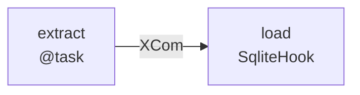
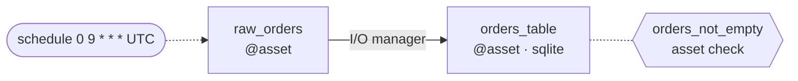

# Airflow to Dagster

A migration is done when the Dagster version does **the same work, on the same data, at the
same times, with the same failure handling** as the DAG. The code rewrite is the easy part.
The silent breakages come from semantics that Airflow handled implicitly: which date a run
processes, what XCom carried, what happened after a branch, and who got paged on failure.

## Pick the path first

| Situation | Path |
|---|---|
| A few DAGs, or the user wants native assets | **Native rewrite** (this skill's workflow) |
| Many DAGs, Airflow must keep running during cutover | **dagster-airlift**: peer → observe → migrate → decommission. Point new users at the Airlift component; the older guides live under `airlift-v1`. |
| One task to move inside a DAG that stays in Airflow | Airlift task-level proxying |

Docs: https://dagster.io/docs/migration/airflow-to-dagster

## Size the answer to the request

- **Concept question** ("how do I convert a PostgresHook?"): answer with the mapping and one
  snippet. No diagrams and no checklist.
- **Full DAG conversion**: follow the workflow below and produce everything under *Output*.

## Workflow for a full conversion

### 1. Inventory the DAG's semantics before writing code

Read the DAG file and list every item below that is present. Each one needs an explicit
decision, so a row that is missing is a behavior that gets dropped.

| Look for | Why it matters | Reference |
|---|---|---|
| `schedule`, `start_date`, `catchup`, timezone (pendulum `tz`) | Decides which interval each run processes | `references/scheduling.md` |
| `{{ ds }}`, `{{ ts }}`, `data_interval_*`, `macros.*`, `logical_date`, `execution_date` in code or templated fields | Become partition keys and time windows | `references/scheduling.md` |
| `depends_on_past`, `max_active_runs`, `wait_for_downstream` | Ordering and concurrency between runs | `references/scheduling.md` |
| XCom: return values, `xcom_pull`, `xcom_push`, size of each payload | Decides I/O manager or external storage | *Data handoff* below |
| `BranchPythonOperator`, `@task.branch`, `ShortCircuitOperator`, `trigger_rule=` | No direct equivalent; joins skip | `references/control-flow.md` |
| `.expand()`, `.partial()`, TaskGroups, SubDAGs | Become dynamic partitions, DynamicOut or groups | `references/control-flow.md` |
| `ExternalTaskSensor`, `TriggerDagRunOperator`, Datasets (`outlets`, `schedule=[Dataset]`) | Cross-DAG links become asset deps | `references/control-flow.md` |
| Operators, Hooks, `conn_id`s, `Variable.get` (including at module top level) | Become resources, Pipes clients or plain Python | `references/operators.md` |
| `retries`, `retry_delay`, `retry_exponential_backoff`, `pool`, `execution_timeout`, `on_*_callback`, `sla`, `email_on_failure` | Operational behavior the team depends on | `references/operations.md` |

If a semantic choice can't be read from the code, such as whether a branch builds the same
table, whether a task is idempotent, or whether a sensor's upstream is also being migrated,
ask the user or state an explicit assumption. **Never guess silently.** List the open
questions in the output.

### 2. Decide what becomes an asset

- A task that **produces data** someone could look at (a table, file or model) → `@dg.asset`.
  Name it after the data (`orders_table`), not the verb (`load_orders`).
- A task that is **only a side effect** (notify, cleanup, trigger, wait) is not an asset. Fold
  it into the asset that needs it (cleanup in a `try/finally`), or make it a sensor or a
  run-status sensor. Use an op job only when nothing fits.
- Several tasks that together build **one** table (create → load → swap) → one asset.

### 3. Write the code with the tested patterns

The `examples/` directory holds runnable versions of each pattern, and `tests/` pins their
behavior (run with `pytest`). Copy from those files instead of writing from memory.

| Example | Covers |
|---|---|
| `examples/basic_etl.py` | TaskFlow → assets, XCom → I/O manager, Connection → `ConfigurableResource` + `EnvVar`, asset check, cron schedule |
| `examples/partitioned_daily.py` | `{{ ds }}` / data interval → `DailyPartitionsDefinition`, Airflow-timed schedule, idempotent rerun, `depends_on_past` |
| `examples/branching.py` | Branch → `if` or optional outputs, ShortCircuit, the join-after-branch fix |
| `examples/dynamic_fanout.py` | `.expand()` → dynamic partitions + sensor, or `DynamicOut` in one run |
| `examples/operations.py` | Retries with backoff, pools, timeout, freshness (SLA), failure sensor, FileSensor, cross-DAG automation |

Rules for the code:

- `import dagster as dg`, and end with a `dg.Definitions(...)` that registers **every** asset,
  check, job, schedule, sensor and resource. Resources and schedules do nothing unless they
  are registered there.
- Keep the business logic byte-for-byte where possible: call the same functions and run the
  same SQL. Change only the orchestration.
- Secrets and connection strings come from `dg.EnvVar`, never literals.
- No Airflow imports in the result. Shared code moves to a package that both sides can import
  during the cutover.

### 4. Prove the behavior matches

Write tests the user can run, and say which ones you could not run.

- `dg.materialize([...], resources=..., partition_key=...)` for each asset, with real or
  temporary resources (for example a SQLite file under `tmp_path`).
- **Schedule timing:** evaluate the schedule at a known tick with `dg.build_schedule_context`
  and assert which partition it requests (see `tests/test_examples.py`).
- **Sensors:** call them with `dg.build_sensor_context(cursor=...)` and check that a second
  tick does not trigger again.
- **Parity:** if the user can run the old DAG, compare the outputs for the same `ds`.

## Data handoff (XCom)

`deps=[...]` sets ordering only. The downstream asset receives **nothing**. Choose one of
these per edge:

| The XCom carried | Use |
|---|---|
| A small value (ids, a dict, a short list) | Upstream asset as a function parameter; the I/O manager carries it |
| A pointer (S3 key, table name) to data stored elsewhere | `deps=[...]`; the downstream reads the known location |
| Large data that passed through XCom (DataFrames) | Write it to real storage in the upstream asset; downstream reads it there. Or use a storage I/O manager (S3, warehouse). |

The default I/O manager writes pickles to the local disk. That works with `dagster dev`, but
it breaks once runs execute in separate pods or machines. For those deployments, set an S3,
GCS or warehouse I/O manager in `Definitions`.

## Concept mapping (quick reference)

| Airflow | Dagster |
|---|---|
| DAG | Asset graph + `define_asset_job` (selection by group or assets) |
| `@task` / Operator that builds data | `@dg.asset` |
| `a >> b` | `deps=[a]` (order) or parameter `def b(a)` (order + data) |
| `schedule="0 9 * * *"` on a DAG without interval logic | `dg.ScheduleDefinition(job=..., cron_schedule=..., execution_timezone=...)` |
| Interval DAG using `ds` / `data_interval_*` | `partitions_def=` + `dg.build_schedule_from_partitioned_job(job)` |
| `catchup=True` | Backfill of the partition range, run deliberately |
| Connection / Hook | `dg.ConfigurableResource` with `dg.EnvVar` |
| `Variable.get` | Resource or run config field |
| `BashOperator`, `KubernetesPodOperator` | `dg.PipesSubprocessClient`, `dagster_k8s.PipesK8sClient` |
| dbt via `BashOperator` | `dagster-dbt` (`@dbt_assets`) |
| Sensor on something outside Dagster | `@dg.sensor` with a cursor |
| `ExternalTaskSensor` / Dataset on a migrated DAG | Asset dependency + `automation_condition=dg.AutomationCondition.eager()` |
| `retries` / `retry_delay` / exponential backoff | `retry_policy=dg.RetryPolicy(max_retries=, delay=, backoff=dg.Backoff.EXPONENTIAL)` |
| `pool=` | `pool=` on the asset + `dagster instance concurrency set <pool> <n>` |
| `max_active_runs` | `concurrency.runs.tag_concurrency_limits` on a job tag |
| `on_failure_callback` | `@dg.run_failure_sensor` |
| `sla` | `freshness_policy=dg.FreshnessPolicy.time_window(fail_window=...)` |
| DAG `tags=[...]` | `group_name` (one per asset) + `tags={"name": ""}` (a dict, not a list) + `kinds` |
| TaskGroup | `group_name` or `key_prefix` |

## Pitfalls that ship broken migrations

1. **Off-by-one interval.** An Airflow run for `ds=2024-01-01` starts on 2024-01-02. A plain
   cron schedule calling "today" processes the wrong day. Use a partitioned schedule; it
   requests the previous complete partition, matching Airflow.
2. **`deps` treated as data passing**, leaving `data = ...` placeholders in the code.
3. **The join after a branch is skipped.** An asset that depends on two optional outputs
   doesn't run when only one was produced (Airflow's `none_failed_min_one_success` would run
   it). Make the join depend on an output that is always produced.
4. **Timezone drift.** Airflow uses the `start_date` timezone. Set the same `timezone=` on
   the partitions definition or `execution_timezone=` on the schedule.
5. **Non-idempotent writes made worse by retries and backfills.** Use delete-then-insert or
   merge per partition before enabling `RetryPolicy` or running a backfill.
6. **Lost alerting.** `on_failure_callback` and `email_on_failure` vanish unless they are
   moved to a run failure sensor.
7. **Module-level `Variable.get` or DB calls** run on every code-location load. Move them
   into resources.
8. **Expecting `catchup`.** Dagster never backfills on deploy. Say so, and give the backfill
   command or UI path.

## Output for a full conversion

In this order:

1. **Inventory table**: each Airflow item found → its Dagster decision.
2. **Two Mermaid diagrams**: the original DAG, then the asset graph (format below).
3. **Code**: complete and runnable, ending in `Definitions`.
4. **Tests**: as described in step 4 of the workflow.
5. **Behavior changes and open questions**: anything that differs from Airflow or rests on
   an assumption.
6. **Checklist**: only the items that apply.

### Mermaid format

- Solid arrows show dependencies. Label each edge with how data moves (`XCom`, `I/O manager`,
  `storage: s3://...`, `deps only`).
- Dashed lines connect schedules, sensors and checks. Show the partition definition on
  partitioned assets.
- Keep fan-out and branches visible, and mark optional outputs.

### Checklist (include the applicable items)

- [ ] Each run processes the same interval as in Airflow (schedule test passes)
- [ ] Timezone matches the DAG's `start_date` timezone
- [ ] Every XCom edge has an explicit handoff; no placeholders
- [ ] Branches and joins behave as before (join test passes)
- [ ] Connections and Variables are resources fed by `EnvVar`
- [ ] Retries, pools, timeouts, alerts and SLAs are carried over
- [ ] Writes are idempotent per partition before any backfill
- [ ] Every definition is registered in `Definitions`; `dagster dev` loads it
- [ ] At least one asset check on each critical output
- [ ] No Airflow imports remain
